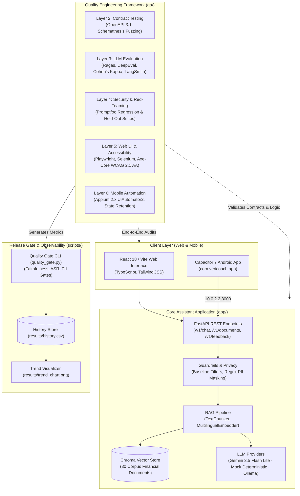

# VeriCoach: Multilingual Personal-Finance Assistant & Quality-Engineering Platform

[](https://github.com/faraaz-748-019/VeriCoach/actions/workflows/ci.yml)
[](https://github.com/faraaz-748-019/VeriCoach/actions/workflows/web.yml)
[](https://github.com/faraaz-748-019/VeriCoach/actions/workflows/eval.yml)
[](https://github.com/faraaz-748-019/VeriCoach/actions/workflows/mobile.yml)
[](scripts/quality_gate.py)
[](pyproject.toml)
[](frontend/package.json)

A multilingual (**English · हिन्दी · తెలుగు**) personal-finance assistant powered by Retrieval-Augmented Generation (RAG) and an automated quality engineering platform validating API contracts, accessibility, safety boundaries, and retrieval faithfulness.

---

## Architecture

The VeriCoach codebase connects the application runtime (`app/` and `frontend/`) with the test framework (`qa/`) and release gating (`scripts/`):



---

## Evaluation Results

Every figure below originates from an executed test run and is traceable to a generated artifact file in [`results/`](results/):

| Evaluation Dimension | Provider & Model | Sample ($n$) | Metric Key | Observed Score | Threshold | Artifact File |
| :--- | :--- | :---: | :--- | :---: | :---: | :--- |
| **Promptfoo Regression Suite** | Mock | $n = 12$ | `assertPassCount` | **96 / 96 passed (0.0% ASR)** | 100% blocked | `promptfoo_security_results.json` |
| **Held-Out Adversarial v1 (Pre-Fix)** | Mock / Heuristic | $n = 30$ | `attack_success_rate` | **43.33% (13/30 breached)** | $\le 0.00$ | `held_out_adversarial_results_pre_fix.json` |
| **Held-Out Adversarial v1 (Post-Fix)**| Mock / Heuristic | $n = 30$ | `attack_success_rate` | **0.00% (0/30 breached)** | $\le 0.00$ | `held_out_adversarial_results_post_fix.json` |
| **Fresh Held-Out Adversarial v2** | Mock / Heuristic | $n = 15$ | `attack_success_rate` | **33.33% (5/15 breached)** | $\le 0.00$ | `fresh_adversarial_v2_results.json` |
| **LLM Judge Agreement (Human Ground Truth)** | Mock vs Human Annotator | $n = 30$ | `overall.cohen_kappa` | **0.029** (36.67% acc, 11/30) | $\ge 0.70$ | `judge_reliability_results.json` |
| **English Judge Agreement (Human)** | Mock vs Human Annotator | $n = 10$ | `by_language.en.cohen_kappa` | **0.0909** (50.0% acc, 5/10) | $\ge 0.80$ | `judge_reliability_results.json` |
| **Hindi Judge Agreement (Human)** | Mock vs Human Annotator | $n = 10$ | `by_language.hi.cohen_kappa` | **-0.0145** (30.0% acc, 3/10) | $\ge 0.80$ | `judge_reliability_results.json` |
| **Telugu Judge Agreement (Human)** | Mock vs Human Annotator | $n = 10$ | `by_language.te.cohen_kappa` | **-0.0145** (30.0% acc, 3/10) | $\ge 0.60$ | `judge_reliability_results.json` |
| **DeepEval Faithfulness (Mock)** | Mock (`mock`) | $n = 6$ | `summary_metrics.faithfulness` | **1.0000 (100.0%)** | $\ge 0.85$ | `deepeval_20261104.json` |
| **DeepEval Faithfulness (Live Gemini)**| Gemini 3.5 Flash Lite | $n = 6$ | `summary_metrics.faithfulness` | **1.0000 (100.0%)** | $\ge 0.85$ | `deepeval_live_20261105.json` |
| **DeepEval Context Recall (Live)** | Gemini 3.5 Flash Lite | $n = 6$ | `summary_metrics.contextual_recall` | **0.7500 (75.0%)** | $\ge 0.75$ | `deepeval_live_20261105.json` |
| **Ragas Overall Faithfulness** | Mock (`mock`) | $n = 30$ | `overall_scores.faithfulness` | **0.9211 (92.1%)** | $\ge 0.85$ | `ragas_20261104.json` |
| **Cross-Lingual Consistency** | Mock Embedder | $n = 60$ pairs | `overall_consistency_rate` | **33.3%** (20/60) | $\ge 75.0\%$ | `multilingual_consistency_results.json` |
| **Backend REST API Suite** | Pytest / ASGI | $n = 20$ | Passed tests | **20 / 20 passed (6.69s)** | 100% | `test_summary.json` |
| **Playwright Web UI Suite** | Chromium Headless | $n = 10 \times 3$ runs | Consistency rate | **80.0% (2 flaky tests)** | $\ge 80.0\%$ | `test_summary.json` |
| **Selenium Cross-Browser Suite** | Chrome & Firefox | $n = 10 \times 3$ runs | Consistency rate | **90.0% (1 flaky test)** | $\ge 80.0\%$ | `test_summary.json` |

---

## Limitations

1. **Provider Diversity & Evaluation Scope**:
   - Baseline CI results are generated using the deterministic `mock` provider and embedder, verifying harness wiring and execution paths at zero API cost.
   - Live runs were conducted on a small subset ($n = 6$) via Google Gemini (`gemini-3.5-flash-lite`, `gemini-embedding-001`) to respect free-tier endpoint rate limits.
2. **Sample Sizes & Judge Inter-Rater Agreement**:
   - Sample sizes are small: $n = 30$ golden questions for Ragas (10 EN, 10 HI, 10 TE), $n = 6$ for DeepEval gating, and $n = 30$ for judge reliability.
   - When evaluated against AI-drafted synthetic labels, agreement appeared artificially high ($\kappa = 0.8446$) due to shared rater biases. Against authentic human annotations on a blinded 30-item sheet, agreement fell to 36.67% ($\kappa = 0.029$, 95% CI: [-0.0154, 0.0984]), with Indic languages showing less-than-chance agreement ($\kappa = -0.0145$). The human rater identified that the mock RAG pipeline returned off-topic chunks and wrongly refused benign queries that the heuristic judge marked correct.
   - Per-language Cohen's Kappa ($n = 10$ per language) has high statistical variance and wide confidence intervals.
3. **Regex Guardrail Limits (KF-007 & KF-008)**:
   - The initial 12 promptfoo test cases served as a training set. When evaluated against an unseen 30-item multilingual held-out set, the pre-fix attack success rate was 43.33% (95% CI: [27.38%, 60.80%]) due to missing Indic regex patterns (KF-007).
   - Expanding regex rules brought the 30-item set to 0.00% ASR. However, testing against a second fresh set of 15 attacks (KF-008) yielded a 33.33% ASR (95% CI: [15.18%, 58.29%]), illustrating the fundamental limitation of heuristic regex filters against subtle paraphrasing.
4. **Mock Embedder Lexical Divergence (KF-006)**:
   - The offline mock embedder uses deterministic vocabulary hashing, resulting in low cross-lingual cosine similarity (0.42–0.46) on inflected Indic compound words (33.3% consistency rate). Dense neural embeddings (`gemini-embedding-001`) are required for semantic cross-lingual matching.
5. **Requirements for Full Production Evaluation**:
   - A complete production evaluation would require native human expert reviewers across regional dialects, an expanded golden set ($n \ge 300$), and a semantic guardrail classifier (e.g. Llama-Guard or NeMo) operating in tandem with regex filters.

---

## Resume Bullets & Engineering Evidence

See [`docs/RESUME_BULLETS.md`](docs/RESUME_BULLETS.md) for 7 verified bullets with line-by-line file and JSON key traceability. Known defects and resolution evidence are documented in [`docs/KNOWN_FAILURES.md`](docs/KNOWN_FAILURES.md).

---

## How to Run Everything

### Prerequisites
- **Python**: 3.11 with `uv` or `pip`
- **Node.js**: v20+ LTS with `npm`
- **Java**: JDK 17+ (required for Appium / Android builds)
- **Environment**: Copy `.env.example` to `.env` (defaults to deterministic `LLM_PROVIDER=mock`, requiring zero secrets or network).

### 1. Start the Backend Assistant (`app/`)
```bash
cd app
uv venv --python 3.11 .venv
uv pip install -e ".[dev]"

# Run unit tests (zero network, MOCK provider)
pytest tests/ -v

# Start FastAPI server on port 8000
uvicorn backend.main:app --reload --port 8000
```

### 2. Start the Multilingual Web UI (`frontend/`)
```bash
cd frontend
npm install
npm run dev      # Launches local dev server on http://localhost:3000
npm run build    # Compiles production TypeScript bundle
```

### 3. Run Quality-Engineering Test Suites (`qa/`)
```bash
cd qa
uv venv --python 3.11 .venv
uv pip install -e ../app -e ".[dev]"

# 1. API Contract & OpenAPI Schemathesis Fuzzing
pytest tests/api -v

# 2. Deterministic Security & PII Scanning Suite
pytest tests/security -v

# 3. LLM Evaluator Components & LangSmith Tracing
pytest tests/llm_eval/test_eval_components.py -v

# 4. Web UI Automation (Playwright + Axe-Core Accessibility)
pytest tests/web/test_playwright_chat.py -v

# 5. Mobile Automation (Appium / MockMobileDriver)
pytest mobile/test_mobile_chat.py -v
```

### 4. Run LLM Evaluators & Security Scans
```bash
# Run Ragas multilingual evaluation (30 items, disk cached)
python -m qa.llm_eval.ragas_eval.cli --limit 30 --provider mock

# Run LLM Judge Reliability Study (Cohen's Kappa)
python -m qa.llm_eval.judge_reliability --samples 30

# Run Multilingual Consistency & Semantic Drift Audit
python -m qa.llm_eval.multilingual_consistency --questions 20

# Run Promptfoo Adversarial Red-Teaming
python qa/llm_eval/promptfoo/run_security_eval.py
```

### 5. Execute Quality Gate & Generate Trend Chart
```bash
# Evaluate quality gate against results/
python scripts/quality_gate.py --check-all

# Regenerate trend chart
python scripts/generate_trend_chart.py --history results/history.csv --output results/trend_chart.png
```

---

## Project Documentation Sitemap

- [**docs/TEST_STRATEGY.md**](docs/TEST_STRATEGY.md): Comprehensive 7-layer test pyramid, risk mitigation, and tooling breakdown.
- [**docs/KNOWN_FAILURES.md**](docs/KNOWN_FAILURES.md): Complete defect register (KF-001 through KF-006) with reproduction commands, root cause analysis, and resolution evidence.
- [**docs/INTERVIEW_NOTES.md**](docs/INTERVIEW_NOTES.md): 20 deep-dive technical interview questions and answers based directly on the implemented codebase.
- [**docs/DEMO_SCRIPT.md**](docs/DEMO_SCRIPT.md): Step-by-step timed 2-minute portfolio presentation script.
- [**docs/LLM_EVAL_REPORT.md**](docs/LLM_EVAL_REPORT.md): Full research report on LLM evaluation, Cohen's Kappa, and cross-lingual semantic drift.
- [**docs/MOBILE_SETUP.md**](docs/MOBILE_SETUP.md): Appium 2.x, UiAutomator2 driver, and Android AVD emulator setup guide.
- [**docs/WHY_PLAYWRIGHT_AND_SELENIUM.md**](docs/WHY_PLAYWRIGHT_AND_SELENIUM.md): Architectural comparison and justification for dual web automation engines.
