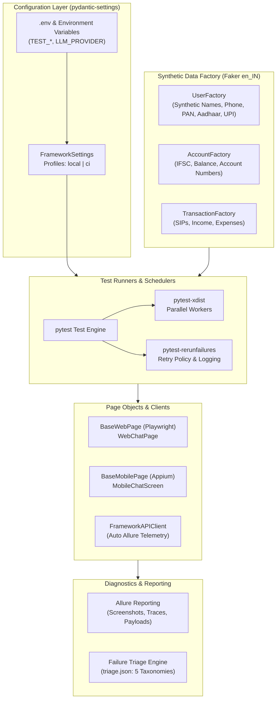

# VeriCoach Quality-Engineering Automation Framework

## 1. Architectural Overview & Design Philosophy

The VeriCoach test automation framework (`qa/framework`) is designed as an internal, enterprise-grade quality-engineering platform rather than a loose collection of test scripts. It provides a unified harness for verifying **VeriCoach**, a multilingual (English, Hindi, Telugu) personal-finance assistant powered by Retrieval-Augmented Generation (RAG).



---

## 2. Directory Layout & Module Topology

```
qa/
├── Dockerfile                   # Hermetic containerized test runner
├── Makefile                     # Subdirectory task runner (test, report, triage)
├── pyproject.toml               # QA dependencies, markers, and tool configs
├── conftest.py                  # Root pytest hooks (retry logger, triage generator)
├── .env.example                 # Example configuration for test runs
├── framework/                   # Core Reusable Framework Package
│   ├── __init__.py              # Public exports
│   ├── config.py                # pydantic-settings with local/ci profiles
│   ├── data_factories.py        # Faker synthetic Indian PII data generators
│   ├── clients/
│   │   ├── __init__.py
│   │   └── api_client.py        # Instrumented HTTP client with Allure logging
│   ├── pages/
│   │   ├── __init__.py
│   │   ├── base_page.py         # Playwright web Page Object base class
│   │   ├── base_mobile_page.py  # Appium mobile Page Object base class
│   │   ├── web_chat_page.py     # VeriCoach web chat interface Page Object
│   │   └── mobile_chat_screen.py# VeriCoach mobile chat Screen Object
│   ├── drivers/
│   │   ├── __init__.py
│   │   └── mock_mobile.py       # Deterministic Appium driver for offline/CI runs
│   ├── fixtures.py              # Shared pytest fixtures (api_client, browser, data)
│   └── reporting/
│       ├── __init__.py
│       ├── allure_helper.py     # Allure attachments (requests, responses, traces)
│       ├── allure_report.py     # Multi-platform Allure HTML compiler script
│       └── triager.py           # 5-taxonomy failure classifier engine
└── tests/
    ├── conftest.py              # Subdirectory fixtures and overrides
    ├── sample/
    │   └── test_framework_samples.py # 5 marker sample acceptance tests
    ├── test_contract_openapi.py # OpenAPI contract conformance
    ├── test_pii_guards.py       # PII guard validation
    ├── test_rag_eval.py         # RAG evaluation metrics (faithfulness, relevancy)
    └── test_safety.py           # Adversarial safety tests
```

---

## 3. Configuration & Profile Architecture

Framework settings are managed through `pydantic-settings` in `qa/framework/config.py`:

```python
class Profile(str, Enum):
    LOCAL = "local"
    CI = "ci"

class FrameworkSettings(BaseSettings):
    profile: Profile = Field(default=Profile.LOCAL)
    base_url: str = "http://localhost:8000"
    browser_type: str = "chromium"
    headless: bool = True
    retry_count: int = 1
    parallel_workers: str = "auto"
    allure_results_dir: Path = Path("qa/allure-results")
    triage_output_path: Path = Path("qa/triage.json")
    llm_provider: str = "mock"
```

### Profile Switching
- **`local`**: Geared for developer workstation debugging. Allows headful browser launching, single retry, and verbose interactive logs.
- **`ci`**: Automatically forces `headless=True`, elevates retries to `>=2`, ensures zero-network mock LLM provider enforcement, and formats outputs for CI job summarizers.

---

## 4. Synthetic Data Engine & Privacy Guardrails

Per strict quality-engineering standards and data protection principles (DPDP Act, GDPR), **no real Personally Identifiable Information (PII) is ever used or stored**.

All test values are synthesized dynamically via `qa/framework/data_factories.py` using localized `Faker("en_IN")`:

| Entity | Pattern / Specification | Example Synthetic Value |
|---|---|---|
| **Name** | Localized Indian (English, Hindi, Telugu) | `Ananya Reddy`, `Vikram Sharma` |
| **Phone** | Indian 10-digit mobile (+91 operator prefix) | `+919876543210` |
| **PAN Card** | 5 Letters (`P` for individual) + 4 Digits + 1 Letter | `BNZPS4821K` |
| **Aadhaar** | 12 digits or masked format | `XXXX-XXXX-8421` |
| **UPI ID** | Synthetic handle + valid bank suffix | `ananya42@okhdfcbank` |
| **Email** | RFC 2606 reserved domains only | `finance.user.9812@example.com` |
| **IFSC Code** | 4-letter bank code + `0` + 6 digits | `HDFC0001234` |

---

## 5. Page Object Model (Web & Mobile)

The framework strictly decouples test logic from DOM and UI locators:

### Web Base Page (`BaseWebPage`)
- Encapsulates Playwright `Page` operations.
- Explicit synchronization via `wait_for_selector(state="visible")`.
- Auto-screenshot on interaction failures attached directly to Allure.
- Wrapped in `@allure.step` for clear hierarchical execution traces.

### Mobile Base Page (`BaseMobilePage` & `MockMobileDriver`)
- Encapsulates Appium `WebDriver` (W3C Actions, touch gestures, element search).
- For headless CI pipelines where an Android emulator/device is unavailable, the framework transparently provides `MockMobileDriver`, guaranteeing deterministic screen interactions without flakiness.

---

## 6. Flakiness Control & Retry Policy

Flaky network glitches or rendering race conditions are handled via `pytest-rerunfailures`. 

A custom pytest hook in `qa/conftest.py` catches every retry event and surfaces the exact reason:

```python
def pytest_runtest_logreport(report: pytest.TestReport) -> None:
    if hasattr(report, "outcome") and report.outcome == "rerun":
        rerun_idx = getattr(report, "rerun", 1)
        reason = str(report.longrepr).splitlines()[-1]
        logger.warning(
            f"[RETRY POLICY] Test '{report.nodeid}' failed on attempt #{rerun_idx}. "
            f"Reason: {reason}. Rerunning..."
        )
        attach_text(f"Retry #{rerun_idx} Reason: {reason}", name=f"Retry Log - {report.nodeid}")
```

---

## 7. Failure Classification & Triage Engine

Failed tests are automatically categorized into a 5-bucket taxonomy by `qa/framework/reporting/triager.py`:

1. **`assertion`**: Functional defect or expectation mismatch (`AssertionError`).
2. **`timeout`**: Downstream service, async event, or UI locator timeout (`TimeoutError`, `ReadTimeout`).
3. **`network`**: Connection refused, DNS failure, socket disconnect (`ConnectError`, `ConnectionRefusedError`).
4. **`element-not-found`**: UI locator selector mismatch (`NoSuchElementException`, `Locator.click timeout`).
5. **`environment`**: Infrastructure or setup defect (`ImportError`, missing `.env`, service down).

At the end of every test session, `qa/triage.json` is generated:

```json
{
  "summary": {
    "total_failures": 2,
    "by_category": {
      "assertion": 1,
      "timeout": 1,
      "network": 0,
      "element-not-found": 0,
      "environment": 0
    }
  },
  "failures": [
    {
      "nodeid": "tests/sample/test_demo.py::test_failure",
      "category": "assertion",
      "message": "assert 100 == 200",
      "traceback": "...",
      "reruns": 1,
      "timestamp": "2026-11-04T06:48:05Z"
    }
  ]
}
```

---

## 8. Allure Observability & Reporting

Every test execution automatically records rich artifacts in `qa/allure-results`:
- **API Request & Response Attachments**: Method, URL, headers, JSON payload, HTTP status code, and millisecond latency.
- **Screenshots**: High-resolution PNG captures taken at each critical verification step and automatically upon locator errors.
- **Playwright Traces**: Trace `.zip` files containing full DOM snapshots, action logs, and network timelines.

To compile the interactive report:
```bash
make report
```
Output is generated to `qa/allure-report/index.html`.

---

## 9. Parallel Execution (`pytest-xdist`)

Tests support parallel distribution across worker threads:
```bash
make test-parallel
# or: pytest qa/tests/sample -n auto
```
- In-memory data generators use isolated random seeds and UUIDs per worker.
- The failure triage hook safely synchronizes master and worker reports, generating a unified `triage.json` on the master controller.

---

## 10. How to Run

### Local Execution
```bash
# Run 5 sample framework tests
make test

# Run tests in parallel with 2+ workers
make test-parallel

# Generate and view Allure HTML report
make report

# Inspect triage classification
make triage

# Code quality checks
make lint
make format
```

### Docker Execution
```bash
# Build the hermetic container
make docker-build

# Run full test suite in container
make docker-run
```
