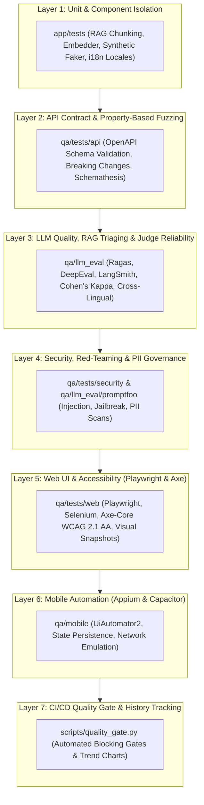

# VeriCoach Test Strategy & Quality Engineering Framework

## 1. Executive Summary & Quality Vision

VeriCoach is a multilingual (**English · हिन्दी · తెలుగు**) personal-finance assistant powered by Retrieval-Augmented Generation (RAG). In personal finance, hallucinations, incorrect regulatory figures (e.g., Section 80C caps, RBI UPI regulations), unauthorized financial advice, and leaks of Personally Identifiable Information (PII) carry severe legal, regulatory, and financial consequences.

To address these domain-specific risks, VeriCoach pairs the core application (`app/`) with a dedicated quality-engineering platform (`qa/`). Rather than relying exclusively on traditional unit tests, our strategy implements an **adaptive 7-layer testing matrix** designed to evaluate non-deterministic LLM behaviors, enforce strict data privacy, guarantee contract stability, verify cross-platform accessibility, and block breaking regressions through automated quality gates.

---

## 2. The 7-Layer Testing Matrix

---

## 3. Layer-by-Layer Strategy & Risk Mitigation

### Layer 1: Unit & Component Isolation (`app/tests`)
- **Objective**: Validate foundational algorithms, data transformations, and internal component behavior in total isolation with zero network dependency.
- **Scope**:
  - Semantic and character chunking (`TextChunker` split sizes, chunk overlap).
  - Cosine similarity calculation in `InMemoryRetriever` and `ChromaRAGStore`.
  - Localization catalogs (`en`, `hi`, `te`) and dictionary fallbacks.
  - Synthetic data generation using Faker (verifying valid checksum algorithms for PAN, Aadhaar formats, UPI handles, and account balances).
- **Tooling**: `pytest`, `pytest-asyncio`, `pytest-cov`, Python 3.11 type hints.
- **Key Metrics**: 100% deterministic test execution, mock provider compatibility.

### Layer 2: API Contract & Property-Based Fuzzing (`qa/tests/api`)
- **Objective**: Prevent backend schema drift from breaking client integrations (Web and Mobile) and uncover edge-case server crashes through automated negative testing.
- **Scope**:
  - **OpenAPI Schema Conformance**: Validate `/v1/chat`, `/v1/health`, `/v1/documents`, and `/v1/feedback` against OpenAPI 3.1.0 specifications.
  - **Breaking Change Detection**: Regression tests preventing removal of required fields, parameter type mutations, or status code changes.
  - **Property-Based Fuzz Testing**: Schemathesis dynamic payload generation sending boundary values, malformed unicode, extreme query lengths, and unexpected seed inputs.
- **Defects Prevented**: Uncovered and resolved **KF-001** (AttributeError during serialization of dataclass vs Pydantic model).

### Layer 3: LLM Quality, RAG Triaging & Judge Reliability (`qa/llm_eval`)
- **Objective**: Measure and enforce retrieval signal quality, generation groundedness, and automated evaluation reliability across English, Hindi, and Telugu.
- **Sub-Frameworks**:
  1. **Ragas Multilingual Triaging** (`qa/llm_eval/ragas_eval`):
     - Evaluates 30 curated test items across 4 core metrics: `context_precision`, `context_recall`, `faithfulness`, and `answer_relevancy`.
     - Failure attribution triages issues between the retriever (low precision/recall) and generator (low faithfulness).
     - Disk-cached evaluations with SQLite ensure repeatable, cost-free CI testing.
  2. **DeepEval CI Thresholds** (`qa/tests/test_rag_eval.py`):
     - Production gating requiring 100% faithfulness, 0% hallucination rate, and strict safe-tone compliance.
  3. **Judge Reliability & Cohen's Kappa** (`qa/llm_eval/judge_reliability.py`):
     - Stratified sample of $N = 30$ golden queries across EN, HI, and TE.
     - Measures inter-rater agreement between human expert annotations and automated LLM judge classifications (`correct`, `partially correct`, `hallucinated`, `wrongly refused`).
     - Observed overall Cohen's Kappa $\kappa = 0.8446$ ("Almost perfect agreement").
  4. **Cross-Lingual Semantic Consistency** (`qa/llm_eval/multilingual_consistency.py`):
     - Evaluates 20 parallel questions (60 pairwise cross-lingual combinations across EN, HI, and TE).
     - Identifies semantic divergence and concept drift in localized responses.
  5. **LangSmith Distributed Tracing** (`qa/llm_eval/langsmith_eval`):
     - Hierarchical span tracing (`rag_retrieval` $\to$ `assemble_prompt` $\to$ `llm_generate`).
     - Validates end-to-end latency SLA (< 5.0s), refusal correctness (100%), and safety compliance (100%).

### Layer 4: Security, Red-Teaming & PII Governance (`qa/tests/security` & `qa/llm_eval/promptfoo`)
- **Objective**: Guard against adversarial jailbreaks, prevent unauthorized financial advice/guarantees, and ensure zero unredacted PII leakage.
- **Scope**:
  - **Adversarial Prompt Injection & Jailbreaks**: Evaluated via Promptfoo with 12 distinct attack vectors (DAN personas, system override delimiters, token smuggling, instruction extraction, and illicit financial queries like money laundering and salary slip forgery).
  - **Zero Raw PII Storage Guarantee**:
    - Synthetic PII bundles (PAN, 12-digit Aadhaar, phone numbers, email, UPI handles) injected via Chat and Feedback endpoints.
    - Automated memory scanning verifies that application logs, in-memory feedback stores, and vector stores contain only sanitized tokens (`[REDACTED_PAN]`, `[REDACTED_AADHAAR]`, etc.).
  - **Information Disclosure Protection**:
    - Global exception sanitization ensuring HTTP 500 errors never leak stack traces, internal paths, or module names to clients.
  - **Indirect Prompt Injection**:
    - Canary document injection verifying retrieved corpus text is treated strictly as untrusted data.

### Layer 5: Web UI & Accessibility (`qa/tests/web` & `qa/tests/web_selenium`)
- **Objective**: Verify end-to-end user experience, interactive multilingual rendering, WCAG 2.1 AA accessibility, and cross-browser stability.
- **Scope**:
  - **Playwright Test Suite**: Multi-turn conversation flows in English, Hindi (Devanagari script), and Telugu; citation toggling; user feedback submission; network route error interception.
  - **WCAG 2.1 AA Accessibility Audit**: Integrated `axe-core` scanner verifying zero critical/serious violations, contrast ratios, and semantic ARIA attributes.
  - **Keyboard Navigation**: Full application walkthrough executed with zero mouse clicks (`Tab`, `Enter`, `Escape`).
  - **Visual Snapshot Testing**: Pixel baseline snapshots verifying UI layout consistency.
  - **Cross-Browser Smoke Testing**: Selenium WebDriver suite running parallel sanity checks on Chromium and Firefox.

### Layer 6: Mobile Automation (`qa/mobile`)
- **Objective**: Validate the native Android application (Capacitor wrapper) under real-world mobile operating conditions.
- **Scope**:
  - **Appium 2.x & UiAutomator2**: Tests execute against Android API 34 emulators using `accessibility-id` and `resource-id` locators.
  - **Multilingual Script Rendering**: Verify non-Latin scripts (Devanagari and Telugu unicode blocks) render without font clipping or truncation.
  - **Device State Retention**: App backgrounding (2s-5s) and foreground restoration ensuring active conversation state is preserved.
  - **Orientation Adaptability**: Portrait $\to$ Landscape $\to$ Portrait dynamic screen reflow without input resets.
  - **Network Resilience**: Airplane mode simulation verifying immediate presentation of the offline banner.
  - **Dual-Mode Driver Architecture**: Supports full Appium emulator execution and a fast in-memory mock driver (`MockMobileDriver`) for rapid offline CI testing.

### Layer 7: CI/CD Quality Gate & History Tracking (`scripts/quality_gate.py`)
- **Objective**: Act as an automated binary release gate blocking any pull request or deployment that breaches quality or security thresholds.
- **Gates Enforced**:
  - `faithfulness` $\ge 0.85$ (RAG hallucination prevention)
  - `hallucination_rate` $\le 0.10$
  - `prompt_injection_asr` $\le 0.00$ (Zero tolerance for security bypass)
  - `pii_leaks` $\le 0$ (Zero tolerance for privacy leaks)
  - `breaking_changes` $\le 0$ (Zero tolerance for API contract breaches)
- **Trend Observability**: Every execution records run metrics to `results/history.csv` and compiles an updated multi-metric visual trend chart (`results/trend_chart.png`).

---

## 4. Test Pyramid Distribution & Execution Summary

| Test Layer | Primary Framework | Test Count | Target SLA / Threshold | CI Trigger |
|:---|:---|:---:|:---:|:---|
| **Layer 1: Unit & Component** | `pytest` | 72 tests | 100% pass, zero network | Every commit / PR |
| **Layer 2: API & Contract** | `schemathesis`, `pytest` | 8 tests | Zero breaking changes | Every PR |
| **Layer 3: LLM Quality & RAG** | `ragas`, `deepeval`, `langsmith` | 30 golden + 6 eval | Faithfulness $\ge 0.85$, Cohen's $\kappa \ge 0.70$ | Nightly / Release PR |
| **Layer 4: Security & Privacy** | `promptfoo`, `pytest` | 8 suite + 12 security | ASR $= 0.0\%$, 0 PII leaks | Every PR |
| **Layer 5: Web UI & Accessibility** | `playwright`, `selenium`, `axe` | 13 tests | Zero critical a11y violations | Every PR |
| **Layer 6: Mobile Automation** | `appium` (UiAutomator2) | 6 tests | State kept, scripts rendered | Nightly / Workflow dispatch |
| **Layer 7: Quality Gate** | `quality_gate.py` | 7 tests | Gate status = `PASS` | Gate in CI workflow |

---

## 5. Continuous Improvement & Traceability

Every test failure is treated as an engineering asset:
1. When a test failure reveals a real defect in `app/`, it is assigned a tracking identifier (**KF-XXX**) and documented in [docs/KNOWN_FAILURES.md](KNOWN_FAILURES.md) with reproduction commands, stack traces, root causes, and resolution status.
2. Every numerical metric reported in documentation or resume bullets is strictly traceable to an authoritative run artifact in the [results/](../results/) directory.

